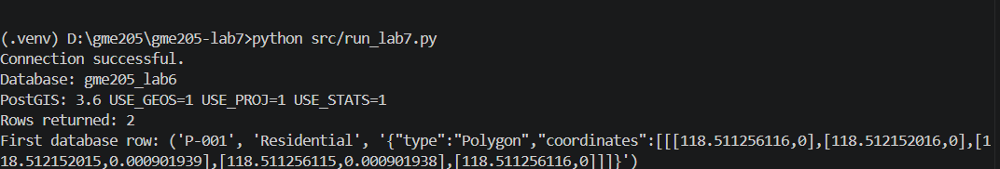
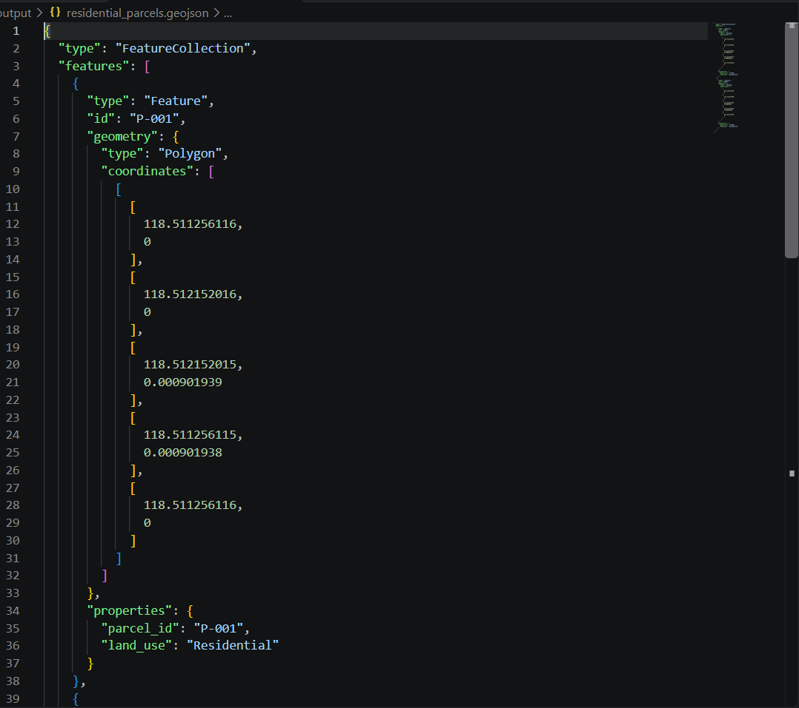
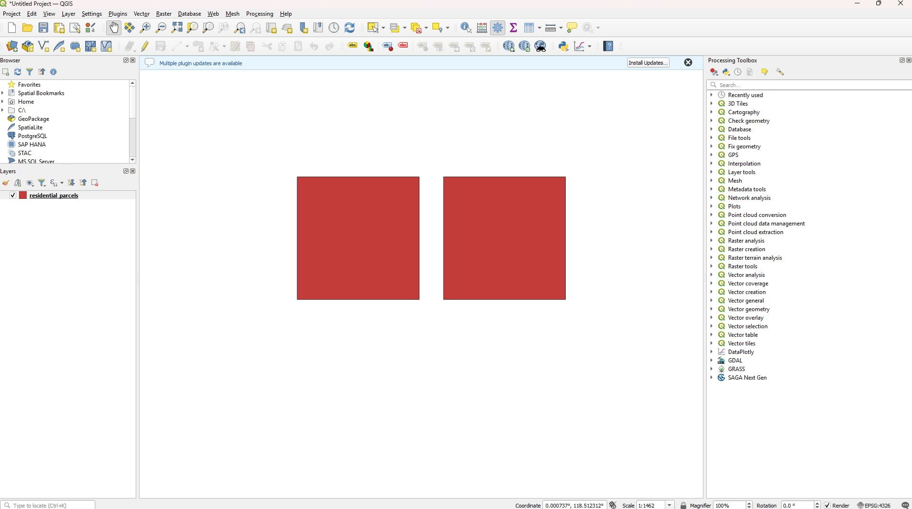

# GmE 205 Laboratory 7 — Python–PostGIS to Interoperable GeoJSON

The main objective of this laboratory activity is to integrate Python with an existing PostgreSQL/PostGIS spatial database to retrieve parcel records, convert database rows into Python objects, and export the spatial data into an interoperable GeoJSON format. This involves establishing a database connection, executing parameterized SQL queries, converting database records into `Parcel` objects, creating a GeoJSON FeatureCollection, and validating the generated output for use in external Geographic Information System (GIS) applications such as QGIS.

### Objectives

The objectives of this laboratory are to:

- Connect Python to an existing PostgreSQL/PostGIS spatial database using external configuration settings.
- Execute parameterized SQL queries to retrieve parcel records based on land-use classification.
- Convert retrieved database rows into Python `Parcel` objects using Object-Oriented Programming (OOP).
- Transform spatial geometries into the WGS 84 coordinate reference system (EPSG:4326).
- Convert Python objects into GeoJSON Features and combine them into a FeatureCollection.
- Validate the structure of the generated GeoJSON before exporting it.
- Export the GeoJSON file and verify its interoperability by displaying the spatial features in QGIS.

### Tools and Technologies

The following tools were used:

- **PostgreSQL 18**
- **PostGIS 3.6.2**
- **pgAdmin 4**
- **Visual Studio Code**
- **Python 3.x**
- **psycopg 3**
- **python-dotenv**
- **JSON / GeoJSON**
- **QGIS**
- **Git**
- **GitHub**

### Database Information

- **Database Name:** `gme205_lab6`
- **Schema:** `lab6`
- **Table:** `parcels`
- **PostgreSQL Version:** 18
- **PostGIS Version:** 3.6.2
- **Source SRID:** 32651 (WGS 84 / UTM Zone 51N)
- **Output SRID:** 4326 (WGS 84)

### How to Set Up the Virtual Environment

1. Open the project folder (`gme205-lab7`) in VS Code.
2. Open the terminal (`Terminal -> New Terminal`) and create the virtual environment:

   ```bash
   python -m venv .venv
   ```

3. Activate the virtual environment:

   ```bash
   .venv\Scripts\activate
   ```

4. Confirm that the terminal prompt shows `(.venv)`.
5. Select the interpreter inside `.venv` using `Ctrl + Shift + P -> Python: Select Interpreter`.
6. Install the required Python libraries:

   ```bash
   pip install "psycopg[binary]" python-dotenv
   ```

7. Generate the `requirements.txt` file:

   ```bash
   pip freeze > requirements.txt
   ```
### Results

The Python program retrieved two residential parcels from PostgreSQL/PostGIS. The records were converted into Parcel objects and then into a GeoJSON FeatureCollection. The FeatureCollection passed the laboratory's basic contract validation and was exported to:

output/residential_parcels.geojson

The generated GeoJSON file was successfully opened in QGIS, displaying two polygon features.

### Laboratory Evidence

#### 1. Python–PostGIS Connection and Validation



#### 2. Generated GeoJSON Output



#### 3. QGIS Visualization



### Data Path

#### 1. PostgreSQL/PostGIS Responsibility

PostgreSQL/PostGIS stores and manages the spatial parcel records, including their attributes and polygon geometries. It also performs spatial operations and retrieves the requested records through SQL queries.

#### 2. Parameterized Query

The land_use value is passed as a parameter instead of being inserted directly into the SQL string. This separates SQL instructions from input values, improving security and helping prevent SQL injection.

#### 3. Database Row to Parcel Object

A database row contains the retrieved parcel data. Converting it into a Parcel object organizes the parcel ID, land use, and geometry into a meaningful Python representation with defined attributes and methods.

#### 4. Parcel Object to GeoJSON Feature

The Parcel object is converted into a GeoJSON Feature containing geometry, properties, and an identifier. This creates a portable representation that can be understood by external GIS applications.

#### 5. Coordinate Transformation

ST_Transform(geom, 4326) converts the source geometry from EPSG:32651 to EPSG:4326. This ensures that the exported GeoJSON coordinates use the WGS 84 longitude and latitude system expected by the GeoJSON standard.

#### 6. GeoJSON and Interoperability

Producing a valid GeoJSON file demonstrates interoperability because the spatial data can be exchanged between different systems. Although no web API was developed, another GIS application can read and display the exported data without needing access to the original Python objects or PostgreSQL database.

### Conclusion

Laboratory 7 demonstrated a complete spatial data exchange workflow, beginning with PostgreSQL/PostGIS, continuing through Python object conversion, and ending with a validated GeoJSON file. The successful visualization of the exported polygons in QGIS confirmed that the data could be consumed by another geospatial application.